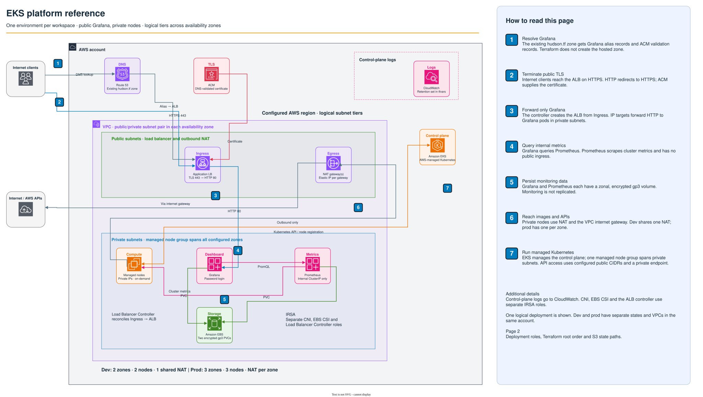

Terraform for an AWS EKS platform with private worker nodes, Prometheus, public HTTPS Grafana, and GitHub OIDC deployments.

[Deploy dev](docs/deployment.md) · [GitHub Actions](docs/github-actions.md) · [Costs](docs/costs.md) · [Cleanup](docs/cleanup.md) · [Verification](docs/verification.md)

## What gets built



[Open full size](docs/architecture.svg) · [Editable draw.io source](docs/eks-platform-reference.drawio) · [Deployment and state flow](docs/github-actions.md)

Dev uses two zones, two small nodes, and one NAT gateway. Prod uses three
zones, three larger nodes, and a NAT gateway in each zone. Worker nodes have
private IPs. The public ALB forwards Grafana traffic; Prometheus stays inside
the cluster. Grafana and Prometheus each use an encrypted gp3 volume.

The drawing shows logical tiers across those zones. A managed node group spans
the private subnets; monitoring runs on those nodes and is not replicated.
The ALB is created by the AWS Load Balancer Controller from the Kubernetes
Ingress. Route 53 provides DNS and ACM provides the ALB's TLS certificate.

## Repository layout

```text
eks-platform-reference/
├── .github/workflows/
│   └── terraform.yml                       # PR plans; manual applies
├── bootstrap/                              # State bucket and GitHub OIDC roles
├── environments/                           # Shared platform root
│   ├── terraform.tfvars                    # Dev/prod settings selected by workspace
│   └── observability/                      # Monitoring root and its own tfvars
├── modules/
│   ├── network/                            # VPC, subnet routing and NAT
│   ├── cluster/                            # EKS, managed nodes, add-ons and IRSA
│   ├── observability/                      # Helm monitoring, public ingress and DNS
│   └── pipeline/                           # Plan/apply role trust and permissions
├── scripts/                                # Checks, CI deployment and cleanup audit
├── tests/                                  # Deployment, PR-comment and audit tests
├── docs/
│   ├── eks-platform-reference.drawio       # Editable, two-page architecture
│   ├── architecture.svg                    # AWS topology preview
│   ├── delivery.svg                        # Deployment and state preview
│   ├── deployment.md                       # Local setup and dev/prod operations
│   ├── github-actions.md                   # Environments, approvals and retries
│   ├── costs.md                            # Hourly/daily estimates and assumptions
│   ├── cleanup.md                          # Teardown and AWS deletion audit
│   └── verification.md                     # Test coverage and live checks
└── README.md
```

Both roots use Terraform CLI workspaces named `dev` and `prod`. All environment
differences live in each root's `terraform.tfvars`, which Terraform loads
automatically. Each file contains an `environments` map; the root selects
`environments[terraform.workspace]`. Changing workspace selects both state and
settings, so plan and destroy need no `-var-file`. Variable validation rejects
`default` and any workspace without configured settings.

The states are separate because Helm needs an existing Kubernetes API, valid
credentials, and ready nodes. A fresh deployment applies the platform before
monitoring. Destruction runs in the opposite order. No targeted apply is needed.

## Before you run it

You need Terraform 1.16.5, AWS CLI v2, kubectl compatible with the configured
Kubernetes version, and an AWS account with room for the nodes, NAT gateways,
and load balancers. Bash, jq, and Python 3 are used by the scripts; the Python code uses only the
standard library. Helm is only
needed if you want to inspect charts yourself; Terraform installs the releases.

Use an AWS profile or SSO session with permission to bootstrap IAM and S3 and
to provision the platform. Configure a persistent IAM administrator role in
`administrator_arns` before applying; use its IAM ARN, not an STS session ARN.
The cluster does not grant implicit administrator access to its creator.

The public `hudson.tf` hosted zone must already exist in the same account, with
its nameservers delegated correctly. Set its exact `hosted_zone_id` in bootstrap
and in both environment entries in `environments/observability/terraform.tfvars`.
Terraform selects that ID and checks the zone name and public-zone setting
before adding Grafana alias records and ACM validation records. It does not create or replace
the zone or register the domain. Use unused Grafana hostnames; existing records
need to be imported or moved deliberately before this configuration owns them.

Review both sets of tfvars. The shipped values use one AWS region; if you change
it, update the AZs, backend region, bootstrap inputs, and GitHub variables as
well. Verify that the configured Kubernetes version is available and in
[standard EKS support](https://docs.aws.amazon.com/eks/latest/userguide/kubernetes-versions.html).
The control plane uses the STANDARD upgrade policy, so AWS can upgrade it at
the end of standard support; schedule explicit upgrades before that happens.

## Run dev first

Use the [deployment guide](docs/deployment.md) to configure inputs, bootstrap the
state bucket and OIDC roles, and initialize both Terraform roots. The guide also
covers Grafana access and the checks to run after deployment.

Once setup is complete, start at the repository root:

```bash
export AWS_PROFILE=dev
cd environments
terraform workspace select dev
terraform plan -out=dev.tfplan
terraform apply dev.tfplan

cd observability
terraform workspace select dev
terraform plan -out=dev-monitoring.tfplan
terraform apply dev-monitoring.tfplan
cd ../..
```

These commands create billable resources. For a short dev verification run,
budget $2–3 for a few hours or $8–10 for a day, then follow the cleanup runbook.
The [full cost breakdown](docs/costs.md) explains the rates and usage charges.

## GitHub Actions

Pull requests run formatting, validation, and offline tests. Approved plans for
same-repository PRs use separate read-only roles for dev and prod and update a
comment per environment with the results. Fork PRs run credential-free checks.

Merging to `main` runs validation only. Applies require a manual workflow run on
`main`, with the environment selected. Prod requires environment approval.
See the [pipeline guide](docs/github-actions.md) for role variables, environment
protection, plan comments, retry commands, and the deployment/state diagram.

## Design decisions

**Managed node groups.** EKS manages node registration, replacement, and rolling
updates. That removes work that would otherwise live in custom launch scripts
and ASG lifecycle hooks. On-demand capacity keeps interruption handling out of
this baseline. Dev uses burstable nodes; sustained CPU loads need different
instance types or incur CPU credit charges. Node counts are explicit: increasing
`max` does not install an autoscaler or automatically grow the cluster.

**OIDC rather than stored AWS keys.** GitHub gets a short-lived session tied to
this repository and an exact GitHub environment. There is no IAM user access key
to rotate or leak in repository secrets. Plan and apply roles are separate, and
IRSA gives the CNI, EBS CSI driver, and ALB controller separate AWS identities.
IMDSv2 is required, with a hop limit that keeps normal pods from relying on node
credentials. The ALB controller receives its region and VPC explicitly.

**Public and private subnets.** Nodes need outbound access for images and AWS
APIs but do not need public IPs. NAT provides that path. Dev shares one NAT to
save money, accepting an availability dependency and cross-zone traffic charges.
Prod routes each private subnet to its local NAT. Public subnets also host the
Grafana ALB. The controller is the standard AWS controller, not a custom operator.

**S3 locking and workspaces.** S3 now supports Terraform lock files directly.
This avoids a separate lock database. Workspaces give the same code distinct
states; auto-loaded tfvars maps supply settings for the selected workspace.
Platform and monitoring are
separate roots because their provider dependencies and teardown order differ.
They look up the existing cluster through AWS, rather than granting monitoring
access to the entire platform state.

**Monitoring storage and ingress.** Prometheus and Grafana use encrypted gp3
volumes with delayed binding to a node's zone. Retention is bounded by time and
size. Neither deployment is replicated; a node failure can interrupt monitoring
while a replacement attaches the zonal volume. Grafana has a public TLS endpoint
because this reference includes internet access. The ALB terminates TLS and
forwards HTTP inside the VPC. Prometheus is not exposed, and alert routing is
not configured. Managed control-plane targets that EKS does not expose are
disabled in the chart instead of leaving permanently failing scrape targets.

**What changes at larger scale.** Separate AWS accounts for prod, private API
access from a VPC runner, SSO for Grafana, a permissions boundary on deployment
roles, and stronger DNS ownership controls come first. Add autoscaling when the
workload requires it. Move metrics to durable remote storage when retention or
availability requirements exceed a single Prometheus volume. Add alert receivers,
backup and restore tests, application ingress policies, and budget alerts with
an actual owner. Measure traffic before adding paid VPC endpoints; an S3 gateway
endpoint is a useful first step to reduce NAT traffic.

Provider versions and Helm charts are pinned. EKS add-ons use AWS's compatible
default for the configured minor version. That default can change; inspect its
version in every plan. Chart upgrades need their upstream upgrade notes,
particularly Prometheus CRD changes. The checked-in controller IAM policy is
from [AWS Load Balancer Controller v2.14.1](https://github.com/kubernetes-sigs/aws-load-balancer-controller/blob/v2.14.1/docs/install/iam_policy.json)
and must be reviewed alongside the controller chart pin.

## Cost

The checked-in estimate is about **$206/month for dev** and **$436/month for
prod**, before usage charges. A 24-hour verification run is about **$6.77 for
dev** or **$14.33 for prod** at the estimated subtotal rates. Allow **$8–10 for
a day of dev** with light traffic and logs. Provisioning and teardown time count.

See [AWS cost estimates](docs/costs.md) for every component, the cost of public
Grafana, short-run budgets, regional assumptions, and pricing sources. Successful
cleanup is part of the estimate: retained load balancers and disks keep billing.

## Checks

```bash
bash scripts/check.sh
bash scripts/test.sh
```

Checks install the locked providers, format-check the repo, validate every root,
and run offline Terraform plans with AWS lookups replaced by fixtures. They do
not contact AWS or create resources. Helm chart rendering is a separate local
check described in [verification](docs/verification.md). Live permissions,
quotas, DNS delegation, cluster readiness, and a second no-change AWS plan must
be checked during the first real deployment. Static validation cannot prove those.

## Tear it down

Follow the [cleanup and API audit runbook](docs/cleanup.md). Capture the AWS
inventory first, destroy monitoring before the platform, and verify that ALBs,
volumes, NAT gateways and public IPs are gone. The runbook covers failed cleanup
and resources that survive Terraform. Bootstrap state and the existing hosted
zone are retained unless explicitly retired.

## What this is not

This is a small platform reference, not a production service or a claim that
workspaces isolate tenants. It has no application deployment, service mesh,
GitOps controller, custom operators, autoscaler, remote metrics storage,
monitoring high availability, disaster recovery, or staffed alert response.
The prod inputs improve node and NAT capacity; they do not create those missing
operating practices. Grafana's password login is a starting point, not a complete
identity system for a team.
