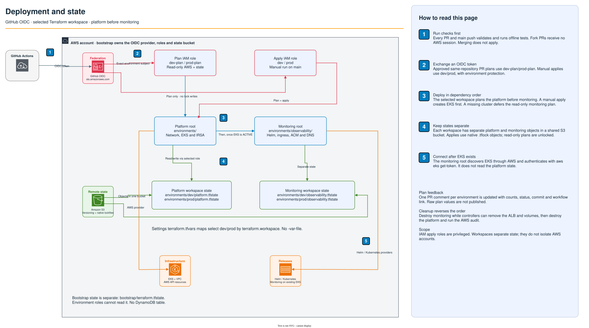

# GitHub Actions

[Repository overview](../README.md) · [Deployment](deployment.md) · [Cleanup](cleanup.md)



[Open full size](delivery.svg) · [Editable source for both pages](eks-platform-reference.drawio)

Create GitHub environments `dev-plan`, `prod-plan`, `dev`, and `prod`. Each needs
these environment variables; they are configuration, not stored AWS secrets:

| Variable | Value |
| --- | --- |
| `AWS_ROLE_ARN` | Corresponding role from bootstrap's `github_role_arns` output |
| `AWS_ACCOUNT_ID` | Account allowed by the AWS credentials action |
| `AWS_REGION` | Region matching tfvars and the state bucket |
| `TF_STATE_BUCKET` | Bootstrap state bucket output |

Restrict deployment branches on `dev` and `prod` to `main`. Require reviewers
for `prod`. Restrict who can approve same-repository PRs against `dev-plan` and
`prod-plan`: plan roles can read state and Kubernetes Secrets to refresh Helm
releases. The plan environments must allow PR refs, not just `main`. Protect
`main`, require the validate job, and require review for changes to workflows,
Terraform, and IAM policies. Environment branch restrictions are essential:
the OIDC environment subject does not itself prove which branch requested it.

Every PR runs formatting, validation, and offline plan tests. Same-repository
PRs also plan both environments using the read-only roles. Fork PRs run the
credential-free checks only. No `pull_request_target` execution is used.

For an environment without a cluster yet, the platform plan runs and the live
monitoring plan is explicitly deferred. Static validation and offline monitoring
plans still run. Once a cluster exists, both live plans run. PR plans are unlocked
because their roles cannot write lock files; they can be stale. Manual applies
create new saved plans under S3 locks and apply those exact files in the same job.
PR plan artifacts are never reused for deployment or published as artifacts.

Each PR plan updates one bot comment per environment with platform and monitoring
resource counts: add, change, destroy and replace. The comment includes the
commit, job result and workflow link. Failed plans and deferred monitoring are
marked explicitly. Comments contain counts only; raw plan values and JSON are
not posted. Retries update the existing comment for that environment.

A merge or push to `main` runs validation only. It does not request AWS
credentials or run a live plan or apply. This lets the demo be merged and
maintained without starting billable infrastructure.
Manual runs select one environment and either `plan` or `apply`; they default
to a dev plan. Manual applies require `main`. Deployment jobs serialize per environment and
are never canceled mid-apply. The prod environment approval sits before AWS
credentials are requested. This is not a sequential dev-to-prod promotion gate.

After the workflow is merged into `main`, use Actions > Terraform > Run workflow
to select the environment and operation, or run:

```bash
gh workflow run terraform.yml --ref main -f environment=dev -f operation=plan
gh workflow run terraform.yml --ref main -f environment=prod -f operation=apply
```

Manual plans use the corresponding `dev-plan` or `prod-plan` environment and
read-only role. Manual applies use `dev` or `prod`, including its approval rules.
To retry a failed PR job before merging, use GitHub's Re-run failed jobs button
or `gh run rerun RUN_ID --failed`. To retry just one environment job, find its
`databaseId` with `gh run view RUN_ID --json jobs --jq '.jobs[] | {name, databaseId}'`,
then run `gh run rerun RUN_ID --job JOB_ID` using that ID.
Plans do not take a state lock, so an active local apply does not block them;
wait until the apply finishes for a reliable result. Applies wait up to five
minutes for the S3 lock. Retry after the other apply finishes if that wait expires.

CI refuses to apply plans that delete or replace the EKS cluster. Those changes need
monitoring-first cleanup and an AWS audit while its controllers still run;
follow [the cleanup procedure](cleanup.md) before changing the cluster's
identity or other settings that require replacement. Initial creation and
in-place updates run normally.

The apply roles can manage EC2 and EKS resources in the configured region,
cluster-prefixed IAM roles, and records in the chosen hosted zone. Direct IAM grants target cluster-prefixed roles, and state-object deletion is
not granted; lock files can be deleted. This is not a permissions boundary:
creating roles and attaching policies can allow privilege escalation beyond
those direct grants, including access to bootstrap identities. Treat apply
workflows and their approvers as fully trusted within this AWS account. These
are privileged infrastructure roles, not least-privilege application roles. Workspaces separate state, not accounts or failure domains. At larger
scale, use separate accounts and backends and narrow IAM permissions further.
